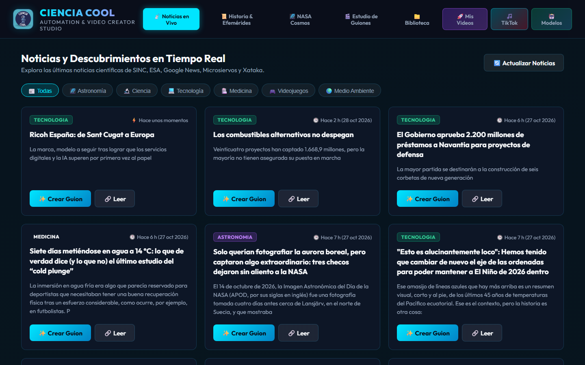

# CIENCIA COOL

Pipeline que convierte una noticia científica en un video corto listo para publicar, y lo sube
solo a YouTube, Instagram, TikTok y Facebook.

[](https://nodejs.org)
[](https://cloud.google.com/run)
[](https://ai.google.dev)
[](https://n8n.io)
[](LICENSE)



**Demo:** https://ciencia-cool-studio-271857970093.us-central1.run.app

## Qué hace

Toma las noticias del día de fuentes RSS (SINC, ESA, Google News, Microsiervos, Xataka), elige la
más publicable, escribe un guion con Gemini, lo narra con síntesis de voz, monta el video con
metraje de archivo e imágenes de la NASA y lo renderiza en MP4 vertical. Después n8n lo publica en
las cuatro redes y borra el archivo del almacenamiento.

El panel web sirve para ver las noticias, generar guiones a mano, elegir voces, revisar la
biblioteca de videos y preparar los textos de TikTok.

## Stack

| Capa | Tecnología |
|---|---|
| Servidor | Node.js 20, Express 5 |
| Generación de texto | Google Gemini (`@google/generative-ai`) |
| Voz | Google Cloud Text-to-Speech y Edge TTS |
| Video | FFmpeg / ffprobe, `sharp` para imágenes, subtítulos con libass |
| Fuentes de contenido | RSS (`rss-parser`), NASA APOD, Pexels, Pixabay |
| Almacenamiento | Google Cloud Storage |
| Orquestación | n8n self-hosted sobre Docker en una VM `e2-micro` |
| Despliegue | Docker sobre Google Cloud Run |
| Publicación | YouTube Data API, Instagram Graph, TikTok Content Posting API, Facebook Graph |

## Cómo funciona

```
RSS / NASA ──► selección ──► guion (Gemini) ──► voz (TTS) ──► render (FFmpeg)
                                                                    │
                                                                    ▼
                                                        Cloud Storage (MP4)
                                                                    │
                                    n8n ◄───────────────────────────┘
                                     │
                     ┌───────────────┼───────────────┬───────────────┐
                     ▼               ▼               ▼               ▼
                  YouTube        Instagram         TikTok         Facebook
```

El pipeline tarda unos 3 minutos. El render se lleva cerca del 60 % del tiempo.

## Estructura del proyecto

```
src/
  server.js          Servidor Express: panel web y API
  cli/               Comandos de línea (news, nasa, history, auto, generate)
  config/            Fuentes RSS y categorías
  services/          Un módulo por responsabilidad: noticias, guion, TTS, medios,
                     render, subtítulos, almacenamiento y una integración por red social
scripts/             Utilidades de mantenimiento
public/              Interfaz del panel
outputs/             Audio, video y temporales (ignorado por git)
Dockerfile           Imagen de producción con FFmpeg
app.yaml             Despliegue alternativo en App Engine
```

## Comandos disponibles

| Comando | Qué hace |
|---|---|
| `npm run news` | Busca las últimas noticias científicas y astronómicas en español |
| `npm run nasa` | Obtiene la imagen y la efeméride del día de la NASA |
| `npm run history` | Efemérides históricas de la ciencia |
| `npm run generate` | Genera un video a partir de un tema concreto |
| `npm run auto` | Elige la mejor noticia y genera el guion completo en JSON y Markdown |
| `npm run gui` / `npm run dev` | Levanta el panel web en local |
| `npm run test:pipeline` | Prueba el endpoint automático sin generar video |

## Configuración

Copia `.env.example` a `.env` y rellena las claves:

```env
GEMINI_API_KEY=tu_clave_de_gemini_aqui
NASA_API_KEY=DEMO_KEY
PEXELS_API_KEY=tu_api_key_de_pexels
PIXABAY_API_KEY=tu_api_key_de_pixabay
PIPELINE_KEY=una_clave_larga_y_aleatoria
```

- **Gemini** (guiones): [Google AI Studio](https://aistudio.google.com/app/apikey)
- **Pexels / Pixabay** (metraje): sin al menos una, los videos salen con tarjetas de título en
  lugar de imágenes reales.
- **PIPELINE_KEY**: protege el endpoint de publicación automática.

## Pipeline automático

`POST /api/pipeline-completo` hace todo el trabajo de una vez: elige una noticia, escribe el guion,
sintetiza la voz, busca el video de archivo y renderiza el MP4. Devuelve un JSON con el video y el
texto listo para publicar en cada red.

**Requiere la cabecera `X-Pipeline-Key`.** Sin ella devuelve `401`. Está cerrada a propósito: el
servidor es público y cada llamada gasta cuota de Gemini y CPU, así que sin clave cualquiera que
encontrara la URL podría generar videos a tu costa. Si la variable `PIPELINE_KEY` no está definida
en el servidor, responde `503`.

```bash
curl -X POST "https://TU-SERVICIO.run.app/api/pipeline-completo" \
  -H "Content-Type: application/json" \
  -H "X-Pipeline-Key: TU_CLAVE" \
  -d '{"categoria": "astronomia"}'
```

### Parámetros del cuerpo

| Campo | Por defecto | Para qué sirve |
|---|---|---|
| `categoria` | rotación automática | `astronomia`, `ciencia`, `tecnologia`, `medicina`, `videojuegos`, `medio_ambiente` |
| `topic` | — | Tema explícito. Si se envía, no se elige noticia de la categoría |
| `voiceId` | `robot-gir` | Cualquier id de `AVAILABLE_VOICES` |
| `format` | `noticia_resumida` | `5_cosas`, `historia_ciencia`, `evento_astronomico` |
| `brandingMode` | `watermark_only` | `watermark_only` o `none` |
| `watermarkPos` | `top-left` | Posición de la marca de agua |
| `watermarkOpacity` | `0.40` | Opacidad de la marca de agua |
| `jobId` | — | Si se repite el mismo, **devuelve el resultado anterior en vez de generar otro video**. Evita duplicados cuando n8n reintenta |
| `dryRun` | `false` | Con `true` no genera nada: solo valida y devuelve el plan. Ideal para probar la configuración de n8n sin gastar cuota |
| `forzar` | `false` | Ignora el candado anti-duplicados. Solo para pruebas manuales a propósito |

### Respuesta

```json
{
  "success": true,
  "elapsedSec": 165,
  "data": {
    "videoUrl": "/video/ciencia_cool_1791249334969.mp4",
    "videoUrlAbsoluta": "https://TU-SERVICIO.run.app/video/ciencia_cool_...mp4",
    "sizeBytes": 18622208,
    "title": "La nueva vaca de la Edad de Hielo",
    "description": "Descripción larga, para YouTube.",
    "caption": "Versión corta, para TikTok e Instagram.",
    "hashtags": ["#cienciacool", "#paleontologia", "#ciencia", "#shorts"],
    "category": "ciencia",
    "source": "ABC",
    "newsTitle": "Titular original de la noticia",
    "jobId": "video-2026-10-06",
    "reutilizado": false,
    "sceneCount": 3,
    "tiempos": { "guion": 12, "audio": 50, "medios": 2, "render": 103 }
  }
}
```

Usa **`videoUrlAbsoluta`**: es pública y es la que necesitan tanto n8n para descargar el archivo
como Instagram para ir a buscarlo al processing.

### Códigos de respuesta

| Código | Cuándo | Qué hacer |
|---|---|---|
| `200` | Todo correcto | Publicar el video |
| `401` | Falta o es incorrecta la clave | Revisar `X-Pipeline-Key` |
| `409` | Candado anti-duplicados: ya hay una pasada en curso o un video recién hecho | **No reintentar**: n8n ya está publicando (o acaba de publicar) ese video |
| `429` | Ya hay una generación en marcha y la cola está llena | Esperar lo que indique `Retry-After` (120 s) y reintentar |
| `500` | Falló la generación | Mirar `steps` para ver en qué paso se rompió |
| `503` | El servidor no tiene `PIPELINE_KEY` configurada | Revisar las variables de entorno del servicio |

### Decisiones de diseño

- **Tarda unos 3 minutos.** El render se lleva ~60 % del tiempo. Si lo orquestas desde n8n, sube el
  timeout del nodo HTTP Request a **480000 ms** (480 s): el valor por defecto son 300 s y se queda
  corto.
- **El video se sube a Google Cloud Storage.** Cloud Run tiene un disco efímero: el MP4 desaparece
  cuando la instancia se reinicia, y la URL del render deja de funcionar a los minutos. Por eso el
  pipeline lo sube a un bucket de GCS y devuelve `videoUrlGcs`, que es permanente. Usa esa URL para
  publicar.
- **Se borra después de publicar.** El workflow de n8n borra el video de GCS nada más terminar de
  publicarlo en todas las redes. Así solo hay un video a la vez en almacenamiento y el coste es de
  céntimos al año.
- **Cloud Run corta respuestas de más de 32 MB.** El render ya limita el archivo a 20 MB de
  presupuesto para que siempre quepa.
- **Candado anti-duplicados.** El 20-oct n8n disparó la pasada de las 8:00 dos veces (08:01 y
  08:04) y se publicaron dos videos del mismo tema. Ahora el pipeline anota en
  `estado/pipeline-candado.json` (en el bucket) qué pasada está en curso y cuál fue la última que
  terminó bien. Antes de generar pregunta: si hay una **en curso** (empezada hace menos de 30 min) o
  una que **terminó bien hace menos de 120 min**, responde `409` y n8n no sube nada. Si una pasada
  falla, el candado se libera y se puede reintentar de inmediato. Los minutos de espera se cambian
  con la variable `PIPELINE_COOLDOWN_MIN`.
- **`GET /api/pipeline-completo/status`** dice si la clave vale, si el servidor está ocupado, qué
  dice el candado y cuántos videos hay en disco, sin generar nada.

## n8n: orquestador de publicación

n8n es el que llama al pipeline y sube el resultado a las redes. Vive en una VM `e2-micro` de Google
Cloud, que entra en el **free tier** en las regiones de US, igual que el resto del proyecto.

| Recurso | Coste |
|---|---|
| VM `e2-micro` en `us-central1-a` | Gratis (free tier) |
| Disco estándar de 30 GB | Gratis (incluye el SO) |
| Docker + n8n self-hosted | Gratis |
| Egreso de red | 1 GB/mes gratis; ~30 videos ≈ 1,8 GB → **~$0,15** |

### El panel no está abierto a internet

n8n escucha en `127.0.0.1:5678` dentro de la VM, así que **no es accesible desde internet**. Ni por
IP ni por ningún puerto. Comprobado: el 5678 da `TcpTestSucceeded: False` desde fuera de la VM.

Se entra por **túnel SSH**:

```bat
Abrir-n8n.bat
```

o a mano:

```bash
gcloud compute ssh ciencia-cool-n8n --zone=us-central1-a -- -L 5678:localhost:5678
```

Luego se abre <http://localhost:5678>. La ventana del túnel tiene que seguir abierta mientras
trabajes en n8n.

La primera vez hay que **crear la cuenta de propietario**. A partir de ahí, n8n pide nombre, correo y
contraseña.

### Ajustes de la VM

La `e2-micro` del free tier tiene **969 MB de RAM**, y n8n corre sobre Node, que es hambriento. Por
eso:

- **2 GB de swap** en `/swapfile` (ya está en `/etc/fstab`, sobrevive reinicios).
- **Tope de memoria al contenedor** (`mem_limit: 700m`, `memswap_limit: 1800m`). Sin tope, n8n se
  comería toda la RAM y lo mataría el OOM killer del kernel, que puede llevarse por delante
  cualquier proceso. Con tope, lo que muere es el contenedor, que n8n reinicia solo gracias a
  `restart: unless-stopped`.
- **Zona horaria** `America/Mexico_City`, para que los horarios de publicación sean los de México y
  no los de UTC.

Si alguna vez n8n va lento o se reinicia solo, mira la memoria primero:

```bash
docker stats --no-stream
docker logs --tail 50 n8n
```

### Mantenimiento

```bash
# Entrar a la VM
gcloud compute ssh ciencia-cool-n8n --zone=us-central1-a

# Reiniciar n8n
cd /opt/n8n && sudo docker compose restart

# Actualizar a la última versión
cd /opt/n8n && sudo docker compose pull && sudo docker compose up -d

# Ver logs
sudo docker logs -f n8n

# Ver la clave de cifrado de credenciales (¡guárdala!)
sudo cat /opt/n8n/.env
```

La clave `N8N_ENCRYPTION_KEY` de `/opt/n8n/.env` cifra todas las credenciales de las redes que se
guarden en n8n. Si se pierde, habrá que volver a meter a mano las claves de YouTube, Instagram y
TikTok. Conviene copiar ese fichero a algún sitio seguro.

### Nota sobre n8n y el puerto 5678

Si al abrir el túnel la página da **404**, no es que esté roto: n8n exige que la petición venga con
la cabecera `Accept` de un navegador. Un `curl` normal (`Accept: */*`) recibe 404, pero el navegador
abre la interfaz sin problema. Para comprobarlo por consola:

```bash
curl -H "Accept: text/html" -o /dev/null -w "%{http_code}\n" http://127.0.0.1:5678/
```

## Pruebas

```bash
npm run test:pipeline              # seguridad, validación y estado (instantáneo)
node test_pipeline.js --real       # además genera un video de verdad (~3 min)
```

La clave se lee de la variable `PIPELINE_KEY` o de `outputs/key.txt`, que está en `.gitignore`.

Las pruebas corren contra el servicio desplegado. Para apuntar a local: `node test_pipeline.js
http://localhost:3000`.

## Licencia

MIT — ver [LICENSE](LICENSE).

---

Proyecto personal de José Ignacio Maldonado Pérez ·
[GitHub](https://github.com/020388jimp-droid) ·
[LinkedIn](https://linkedin.com/in/jos%C3%A9-ignacio-maldonado-p%C3%A9rez-4592a7157)
